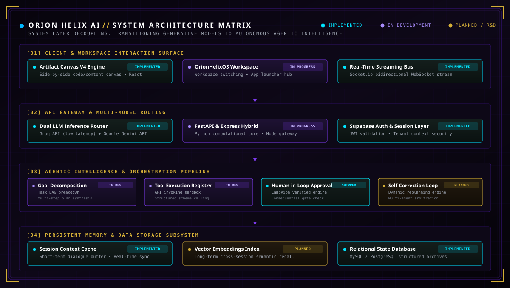
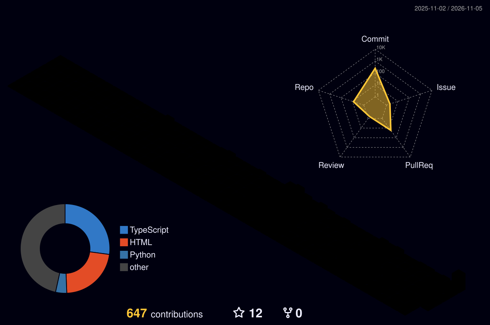

<div align="center">



<br>


<br>


<br><br>

<a href="https://github.com/debajit-ai"></a>
<a href="https://github.com/SingularityHorizon"></a>
<a href="https://www.linkedin.com/in/debajit-goswami-363a8b317/"></a>
<a href="https://x.com/debajit_go60813"></a>
<a href="mailto:debajit.singularity@proton.me"></a>

<br><br>


<br><br>

<p><i>"Engineering the sovereign systems layer where artificial intelligence evolves from stateless prompts into coordinated, persistent, autonomous software."</i></p>

</div>

---

## ◈ SYSTEM TELEMETRY & FOUNDER IDENTITY

```text
┌────────────────────────────────────────────────────────────────────────────────────────┐
│ // SYSTEM IDENTITY MATRIX — FOUNDER TELEMETRY & WORKSPACE PROFILE                      │
├────────────────────────────────────────────────────────────────────────────────────────┤
│                                                                                        │
│  EXECUTIVE      │ Debajit Goswami                                                      │
│  POSITION       │ Founder & CEO — Singularity Horizon Technologies Pvt. Ltd.           │
│  DISCIPLINE     │ AI Systems Engineer · AI/ML Developer · Distributed Systems          │
│  ACADEMICS      │ B.Tech Computer Science & Engineering (Artificial Intelligence & ML) │
│                 │ Lovely Professional University · Class of 2029                       │
│  COORDINATES    │ Punjab, India [31.25°N, 75.70°E]                                     │
│                                                                                        │
│ ────────────────┼───────────────────────────────────────────────────────────────────── │
│                                                                                        │
│  PRIMARY ENGINE │ ORION HELIX AI — Flagship Generative & Agentic Intelligence Platform │
│  CORE DOMAINS   │ Multi-Agent Task Orchestration · Long-Term Context & Memory Systems  │
│                 │ Dual-LLM Inference Routing · High-Throughput Distributed Microservices│
│                 │ Real-Time Communication Pipelines · GPU-Accelerated 3D WebGL Graphic │
│                                                                                        │
│  COMPUTE RIG    │ Acer Nitro V15 · AMD Ryzen 5 · NVIDIA GeForce RTX 3050 (AI Compute)  │
│  OPERATING ENV  │ Windows 11 Pro + WSL2 (Ubuntu Linux) · VS Code · Git / GitHub Actions│
│                                                                                        │
│  CORE AXIOM     │ SYSTEMS OVER DEMOS.                                                  │
│                 │ Build for long-term technological leverage. Zero-mock telemetry.     │
│                                                                                        │
└────────────────────────────────────────────────────────────────────────────────────────┘
```

---

## ◈ SINGULARITY HORIZON TECHNOLOGIES PVT. LTD.

<div align="center">



</div>

<br>

**Singularity Horizon Technologies Pvt. Ltd.** is an independent AI technology venture established to design, engineer, and deploy intelligent software platforms and next-generation interactive systems.

Modern AI applications frequently suffer from a fundamental engineering bottleneck: **isolated, stateless, single-turn interactions**. Singularity Horizon exists to build the sovereign infrastructure layer that makes AI models reliably useful over long operational horizons — coordinating agents, persisting semantic state, recovering from runtime failures, and collaborating with human operators.

<br>

### ◈ Strategic Product Fleet

* **ORION HELIX AI** — Flagship platform engineering the bridge from generative LLM inference to stateful, multi-agent autonomous intelligence.
* **CampVion (Project 55)** — Intelligent Campus Operations platform demonstrating true agentic behavior: goal decomposition, tool orchestration, dynamic failure replanning, and human-in-the-loop approval.
* **BLACK-WEB** — Personal AI operating system powered by ORION Core, featuring a three-column cyber-operator console, real backend memory endpoints, and an uncompromising zero-mock telemetry philosophy.
* **Singularity Horizon 3D Experience** — Cinematic digital identity engineered as a spatial, scroll-driven 3D web experience with custom WebGL GLSL shaders and lightweight Zustand state architecture.
* **NEXORA** — Exploratory research laboratory investigating distributed architectures and high-concurrency systems.

<div align="center">

<a href="https://github.com/SingularityHorizon">

</a>

</div>

---

## 🧠 FLAGSHIP PLATFORM: ORION HELIX AI
### *The Multiverse of Artificial Intelligence*

<div align="center">



</div>

<br>

**ORION HELIX AI** represents the core technical investment under Singularity Horizon Technologies. It is not an ephemeral chatbot or an API wrapper. It is being architected as a **composable AI systems layer** designed to eliminate the architectural statelessness of contemporary generative AI.

<br>

<details>
<summary><b>◈ The Core Engineering Problem — Why ORION HELIX AI Exists (Click to expand)</b></summary>

<br>

Most current AI applications are fundamentally stateless:
- Every conversation resets from ground zero.
- Every tool execution is an isolated API invocation without execution tracing.
- Agent failures silently cascade without deterministic error-recovery boundaries.
- Models operate in passive question-answering loops rather than active human-AI collaboration.

**ORION HELIX AI** addresses this through a layered systems architecture:
1. **Multi-Model Routing Gateway:** Dynamically routes prompts between ultra-fast inference engines (Groq API) and comprehensive multimodal reasoning models (Google Gemini API).
2. **Deterministic Agentic Orchestration:** Decomposes complex human instructions into directed acyclic task graphs (DAGs), verifies preconditions, and executes tools within controlled sandboxes.
3. **Multi-Tiered Memory:** Couples short-term session buffers with long-term vector embeddings, ensuring persistent context and semantic recall across disparate sessions.
4. **Artifact-Driven Collaboration:** Replaces conventional text chat with a synchronized dual-surface workspace (`Artifact Canvas V4`) enabling users and AI to inspect and modify live artifacts simultaneously.

</details>

<br>

### ◈ ORION HELIX AI — Verified Capability Classification Matrix

To adhere strictly to our **Systems Over Demos** philosophy, capabilities are classified with complete technical transparency:

| Subsystem / Layer | Capability & Architecture | Classification | Stack & Verification |
|:---|:---|:---:|:---|
| **Dual-LLM Router** | Dynamic routing between low-latency inference and multimodal analysis | `IMPLEMENTED` | Groq API + Google Gemini API dual-backend integration |
| **Streaming Engine** | Full-duplex bidirectional streaming of reasoning tokens and artifacts | `IMPLEMENTED` | Socket.io WebSocket architecture & event handling |
| **Chat Foundation** | Full-stack chat application with session history and authentication | `IMPLEMENTED` | Node.js, Express, MySQL database, Supabase Auth |
| **Artifact Canvas V4** | Side-by-side workspace canvas for real-time code and artifact rendering | `IMPLEMENTED` | React component engine, Tailwind CSS, Composer toolbar |
| **OrionHelixOS** | Multi-workspace switcher, application launcher, and telemetry center | `IN DEVELOPMENT` | Modular `OrionHelixOS` class architecture in TypeScript |
| **Python Services** | High-performance asynchronous microservice for AI computation | `IN DEVELOPMENT` | FastAPI, Pydantic schemas, Python 3.11+ runtime |
| **Agent Infrastructure** | Goal decomposition, tool registry, structured output validation | `IN DEVELOPMENT` | DAG task planning engine & schema-enforced tool execution |
| **Persistent Memory** | Cross-session semantic recall and vector embedding storage | `PLANNED` | Multi-tiered memory combining session cache with vector store |
| **Unified Multimodal** | Unified streaming context synchronizing audio, vision, and text | `PLANNED` | Real-time multimodal streaming pipeline |
| **Autonomous Multi-Agent** | Coordinated multi-agent loops with automated self-healing | `PLANNED` | Decentralized agent execution loops & consensus protocol |
| **Production API Gateway** | Public tenant-isolated gateway with compute sandboxes | `LONG-TERM RESEARCH` | Distributed edge routing and containerized isolation |

<div align="center">

<a href="https://github.com/debajit-ai/orion-helix-showcase">

</a>
<a href="https://github.com/SingularityHorizon/orion-helix-docs">

</a>

</div>

---

## 🚀 FEATURED ENGINEERING REPOSITORIES

<table width="100%">
<tr>
<td width="50%" valign="top">

### 🧠 ORION HELIX AI — Public Showcase


<br><br>

Public-facing architecture, roadmap, and design documentation showcase for the **ORION HELIX AI** platform. Documents system-level routing, component matrices, and interface design while proprietary core engines remain in active development.

- **Stack:** React &bull; Node.js &bull; Express &bull; FastAPI &bull; Socket.io &bull; MySQL &bull; Supabase
- **Key Contribution:** Specification of dual-model routing, modular artifact canvas rendering, and agent infrastructure roadmap.
- **Repository:** [`debajit-ai/orion-helix-showcase`](https://github.com/debajit-ai/orion-helix-showcase)

</td>
<td width="50%" valign="top">

### ⚡ CampVion (Project 55)


<br><br>

Intelligent Campus Operations platform engineered with a **genuine agentic architecture**. Unlike static chatbots that rely on keyword intent matching, CampVion autonomously handles multi-step operational workflows with dynamic replanning.

- **Stack:** TypeScript &bull; Node.js &bull; Agentic Tool Orchestration &bull; Execution Tracing
- **Key Contribution:** Implemented autonomous goal decomposition, runtime tool failure recovery, and strict human-in-the-loop approval gates for sensitive operations.
- **Repository:** [`debajit-ai/CampVion`](https://github.com/debajit-ai/CampVion)

</td>
</tr>

<tr>
<td width="50%" valign="top">

### ⬛ BLACK-WEB


<br><br>

A personal AI operating system powered by the **ORION Core** backend. Built with a three-column cyber-operator console, real backend memory endpoints, and an uncompromising zero-mock telemetry principle.

- **Stack:** React &bull; Vite &bull; Framer Motion &bull; FastAPI &bull; PostgreSQL &bull; ORION Core
- **Key Contribution:** Engineered real backend memory endpoints, responsive telemetry chips, and modular CommandConsole UI.
- **Repository:** Private &bull; In active development under Singularity Horizon

</td>
<td width="50%" valign="top">

### 🌐 Singularity Horizon — 3D Experience


<br><br>

The official digital identity for Singularity Horizon Technologies — engineered as a cinematic, spatially navigable 3D digital experience. Features scroll-driven chapters, manager pattern state store, and GPU shader effects.

- **Stack:** React &bull; Vite &bull; TypeScript &bull; Three.js &bull; R3F &bull; GSAP &bull; Tailwind &bull; Zustand &bull; GLSL
- **Key Contribution:** Custom GLSL WebGL shader pipeline and lightweight Zustand state synchronization for seamless 3D rendering.
- **Repository:** Private &bull; In active development

</td>
</tr>

<tr>
<td width="50%" valign="top">

### 🌌 Hacking Portfolio


<br><br>

Cinematic 3D developer portfolio featuring real-time WebGL physics simulations, black hole accretion disk shaders, particle fields, and hardware-accelerated post-processing.

- **Stack:** Next.js &bull; React &bull; TypeScript &bull; Three.js &bull; R3F &bull; Framer Motion &bull; GSAP &bull; Lenis
- **Key Contribution:** Procedural accretion disk shader algorithms, smooth physics scrolling, and interactive 3D scene optimization.
- **Repository:** [`debajit-ai/hacking-portfolio`](https://github.com/debajit-ai/hacking-portfolio) &bull; **Live:** [hacking-portfolio.vercel.app](https://hacking-portfolio.vercel.app)

</td>
<td width="50%" valign="top">

### 🔋 SmartParkEV


<br><br>

Smart EV parking and charging management platform designed and shipped end-to-end in 24 hours during an intensive hackathon. Demonstrates rapid product delivery under extreme constraints.

- **Stack:** HTML5 &bull; CSS3 &bull; JavaScript &bull; REST API Integration
- **Key Contribution:** Real-time parking slot visualizer, EV charging telemetry dashboard, and station reservation mechanics.
- **Repository:** [`debajit-ai/SmartParkE.V`](https://github.com/debajit-ai/SmartParkE.V)

</td>
</tr>
</table>

---

## 🛠 TECHNICAL CAPABILITY MATRIX

<div align="center">

### ◈ CORE PROGRAMMING LANGUAGES


<br>

`Python (AI/ML & Distributed Backends)` &bull; `TypeScript (Full-Stack & Systems)` &bull; `JavaScript (Universal Runtime)` &bull; `C / C++ (Low-Level Systems & DSA)` &bull; `Java (Object-Oriented Design)`

<br><br>

### ◈ AI, AGENTIC SYSTEMS & DISTRIBUTED INFRASTRUCTURE


<br>

| Engineering Domain | Specialized Capabilities & Subsystems |
|:---|:---|
| **AI & Machine Learning** | Python &bull; PyTorch &bull; TensorFlow &bull; Hugging Face Transformers &bull; Neural Network Architectures &bull; Model Evaluation |
| **Generative AI & LLMs** | Multi-Model Routing (Groq API, Google Gemini API) &bull; Prompt Engineering &bull; Structured Outputs &bull; Context Window Optimization |
| **Agentic Workflows** | Autonomous Goal Decomposition &bull; Dynamic Replanning &bull; Tool Orchestration &bull; Execution Tracing &bull; Human-in-the-Loop Gates |
| **Backend & Distributed Systems**| Node.js &bull; Express.js &bull; FastAPI &bull; RESTful API Design &bull; Socket.io (WebSockets) &bull; Supabase BaaS &bull; Microservices |
| **Databases & Data Modeling** | PostgreSQL &bull; MySQL &bull; SQLite &bull; Relational Data Architecture &bull; Vector Embeddings &bull; Semantic Search Indices |

<br><br>

### ◈ FRONTEND, 3D GRAPHICS & DEVOPS INFRASTRUCTURE


<br>

| Engineering Domain | Specialized Capabilities & Subsystems |
|:---|:---|
| **Frontend Engineering** | React &bull; Next.js &bull; Tailwind CSS &bull; Framer Motion &bull; GSAP &bull; Lenis &bull; Zustand Lightweight State Store |
| **3D Web & Computer Graphics** | Three.js &bull; React Three Fiber (R3F) &bull; WebGL &bull; Custom GLSL Shaders &bull; Post-Processing Rendering Pipelines |
| **DevOps & Infrastructure** | Git &bull; GitHub &bull; GitHub Actions CI/CD Automation &bull; Vercel Cloud Deployment &bull; WSL2 / Ubuntu Linux &bull; VS Code |

</div>

---

## 📊 ENGINEERING COMMAND CENTER

<div align="center">


<br>

<table width="100%">
<tr>
<td width="50%" align="center" valign="middle">
<b>COMMIT STREAK &amp; RESILIENCE</b><br><br>

</td>
<td width="50%" align="center" valign="middle">
<b>OVERALL REPOSITORY METRICS</b><br><br>

</td>
</tr>
<tr>
<td width="50%" align="center" valign="middle">
<b>LANGUAGE DISTRIBUTION (REPOSITORIES)</b><br><br>

</td>
<td width="50%" align="center" valign="middle">
<b>COMMIT FREQUENCY BY LANGUAGE</b><br><br>

</td>
</tr>
</table>

<br>

### ◈ 3D CONTRIBUTION TIMELINE VISUALIZATION
*Automated daily generation via GitHub Actions CI/CD workflow*



<br><br>


</div>

---

## ⚡ ACTIVE ENGINEERING RADAR

```text
┌────────────────────────────────────────────────────────────────────────────────────────┐
│ // ACTIVE ENGINEERING FOCUS & LIVE DEVELOPMENT TELEMETRY                               │
├────────────────────────────────────────────────────────────────────────────────────────┤
│                                                                                        │
│  [● ACTIVE BUILD]      ORION HELIX AI — Agent Infrastructure & Task Routing Layer      │
│                        FastAPI microservices, tool execution sandbox, and Gemini API.  │
│                                                                                        │
│  [● ACTIVE BUILD]      Singularity Horizon — Cinematic 3D Spatial Digital Identity     │
│                        Scroll-driven WebGL scene chapters, custom GLSL lighting shaders│
│                                                                                        │
│  [◐ IN PROGRESS]       BLACK-WEB — Personal AI OS (ORION Core)                         │
│                        Operator dashboard styling and live PostgreSQL telemetry feeds. │
│                                                                                        │
│  [◐ IN PROGRESS]       NEXORA — Systems Architecture Experiment                        │
│                        Distributed compute & state synchronization research.           │
│                                                                                        │
│  [○ UPCOMING R&D]      ORION HELIX — Persistent Long-Term Memory Subsystem             │
│                        Multi-session vector embedding recall and context caching.      │
│                                                                                        │
│  [○ UPCOMING R&D]      Unified Multimodal Processing Pipeline                          │
│                        Synchronous audio and visual streaming integration.             │
│                                                                                        │
└────────────────────────────────────────────────────────────────────────────────────────┘
```

---

## 🧭 FOUNDER STORY & ENGINEERING PHILOSOPHY

<div align="center">


</div>

<br>

> **"A model call wrapped in a chat interface is a demo. A resilient, stateful, self-recovering workflow is a system."**

As a founder and AI systems engineer, my commitment is to build technology that compounds over time. The era of building superficial model wrappers has passed; the real engineering challenge is building the **systems architecture** that enables artificial intelligence to become genuinely sovereign, reliable, and collaborative:

1. **Systems Over Demos:** Flashy demonstrations fade when subjected to real-world edge cases. We prioritize robust architecture, error boundaries, and state consistency.
2. **Strict Telemetry & Zero Mock Data:** Honesty is our foundational engineering discipline. What is shipped is labeled shipped. What is in development is labeled in development. Never fake metrics, uptime, or capabilities.
3. **Fault Tolerance & Dynamic Replanning:** Real-world network calls fail, APIs change, and models hallucinate. Resilient systems integrate deterministic human-in-the-loop approval gates, fallback inference routes, and execution audit trails.
4. **State & Memory as Primitives:** Real collaboration requires memory across sessions. A software partner that forgets context upon disconnect is merely a calculator; true intelligence requires persistent recall.
5. **Continuous Execution & Compounding Leverage:** Great systems are engineered through daily disciplined commits, automated CI/CD pipelines, and relentless shipping in public.

---

## 🎓 ACADEMIC BACKGROUND & CERTIFICATIONS

<table width="100%">
<tr>
<td width="50%" valign="top">

### 🎓 Academic Degree
**Bachelor of Technology (B.Tech)**  
*Computer Science & Engineering — Artificial Intelligence & Machine Learning*  
**Lovely Professional University**, Punjab, India  
**Duration:** 2025 – 2029 (Expected)

Core focus areas include: Advanced Data Structures & Algorithms, Deep Learning Architectures, Distributed Systems, Operating Systems, Database Management Systems, and Natural Language Processing.

</td>
<td width="50%" valign="top">

### 🎖 Verified Certifications
| Credential | Domain & Scope |
|:---|:---|
| **Google Foundations of AI & ML** | Machine learning concepts & Google AI infrastructure |
| **Data Science Specialist** | Statistical modeling, data pipelines & visualization |
| **Cyber Security Fundamentals** | Network protocols, threat modeling & security basics |

</td>
</tr>
</table>

---

## 🌐 VERIFIED COORDINATES & CONNECT

<div align="center">

Open to strategic collaborations, deep engineering discussions on agentic architectures, and enterprise conversations regarding Singularity Horizon Technologies.

<br>

<a href="https://github.com/debajit-ai">

</a>
<a href="https://github.com/SingularityHorizon">

</a>
<a href="https://www.linkedin.com/in/debajit-goswami-363a8b317/">

</a>
<a href="https://x.com/debajit_go60813">

</a>
<a href="mailto:debajit.singularity@proton.me">

</a>

</div>

<br>

---

<div align="center">



<br>

```text
DEBAJIT GOSWAMI
Founder & CEO — Singularity Horizon Technologies Pvt. Ltd.
Engineering the Sovereign Systems Layer of Tomorrow.
```


</div>
